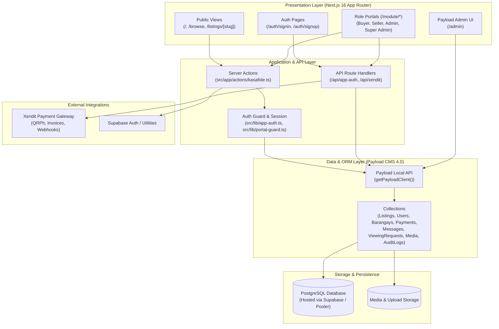

# Kasafide — Real Estate Marketplace Platform

Kasafide is a verified real estate and property rental marketplace tailored for Santa Maria, Bulacan, Philippines. It features localized barangay-level property mapping, multi-role portal management (Buyer, Seller, Admin, Super Admin), direct messaging, viewing requests, and payment processing via Xendit.

---

## 1. Where the System Is (Overview & Stack)

### Technology Stack
* **Framework:** [Next.js 16](https://nextjs.org/) (App Router) + [React 19](https://react.dev/)
* **Headless CMS & ORM:** [Payload CMS 4.0 (beta)](https://payloadcms.com/)
* **Database:** PostgreSQL (Self-hosted via Supabase / Postgres connection pooler)
* **Styling:** [Tailwind CSS v4](https://tailwindcss.com/) with PostCSS & Radix UI primitives
* **Authentication:** NextAuth / Payload JWT session cookie / Supabase client integration
* **Payments:** [Xendit](https://www.xendit.co/) (Invoices, QR code payments, Webhook callbacks)
* **Icons & UI:** Lucide React icons, Monaco editor, Radix Dialog / Label / Slot

### Key Configuration Files
* **Payload CMS Config:** `src/payload.config.ts` (collections, database adapter, plugins)
* **Next.js Config:** `next.config.ts` (Payload wrapper, image domains, server actions)
* **Tailwind & Theme:** `src/app/(frontend)/styles.css`
* **Environment Variables:** `.env` / `.env.example`
* **TypeScript Types:** `src/payload-types.ts` (auto-generated by Payload)

---

## 2. Where to Edit the Frontend

All user-facing frontend code lives under `src/app/(frontend)/` and `src/components/`.

```
src/
├── app/
│   └── (frontend)/                  # Next.js App Router root layout & pages
│       ├── layout.tsx               # Root HTML, fonts, and global shell
│       ├── page.tsx                 # Homepage / Landing page
│       ├── styles.css               # Tailwind CSS v4 & theme variables
│       ├── about/                   # About Us page & team components
│       ├── browse/                  # Public property search & filter catalog
│       ├── listings/[slug]/         # Dynamic property detail view
│       ├── faqs/                    # Frequently asked questions
│       ├── help/                    # Help center
│       ├── auth/                    # Sign-in, sign-up, forgot-password forms
│       └── module/                  # Role-based dashboard portals
│           ├── buyer/               # Buyer dashboard & management
│           ├── seller/              # Seller dashboard, listings manager, MOA
│           ├── admin/               # Admin management & review panel
│           └── super-admin/         # Super Admin audit trails & settings
└── components/
    ├── kasafide/                    # Domain-specific UI components
    │   ├── HomeLandingClient.tsx    # Interactive landing page logic
    │   ├── PublicNavbar.tsx         # Global top navigation bar
    │   ├── PublicFooter.tsx         # Global footer
    │   ├── PropertyCard.tsx         # Property card item component
    │   ├── BrowseCatalogClient.tsx  # Search catalog & filtering UI
    │   ├── ListingDetailClient.tsx  # Full listing details view
    │   ├── StaMariaMapSection.tsx   # Interactive Santa Maria barangay map
    │   ├── MessengerWorkspace.tsx   # Live chat / messaging interface
    │   ├── PortalShell.tsx          # Reusable dashboard sidebar/header shell
    │   ├── SignInClient.tsx         # Sign-in form component
    │   └── SignUpClient.tsx         # Sign-up form component
    └── ui/                          # Reusable UI primitives (buttons, cards, dialogs)
```

### Quick Editing Guide
1. **Landing Page:** Edit `src/app/(frontend)/page.tsx` and `src/components/kasafide/HomeLandingClient.tsx`.
2. **Navigation & Header:** Edit `src/components/kasafide/PublicNavbar.tsx`.
3. **Property Search & Filters:** Edit `src/app/(frontend)/browse/page.tsx` and `src/components/kasafide/BrowseCatalogClient.tsx`.
4. **Property Details Page:** Edit `src/app/(frontend)/listings/[slug]/page.tsx` and `src/components/kasafide/ListingDetailClient.tsx`.
5. **Interactive Map:** Edit `src/components/kasafide/StaMariaMapSection.tsx`.
6. **User Portals:** Edit the respective directory under `src/app/(frontend)/module/[buyer|seller|admin|super-admin]/`.
7. **Colors, Fonts & Base Styles:** Edit `src/app/(frontend)/styles.css`.

---

## 3. Routes Structure

### 🌐 Public & Information Routes
| Route | File Path | Description |
| :--- | :--- | :--- |
| `/` | `src/app/(frontend)/page.tsx` | Homepage & hero section |
| `/browse` | `src/app/(frontend)/browse/page.tsx` | Property catalog with search & filters |
| `/listings/[slug]` | `src/app/(frontend)/listings/[slug]/page.tsx` | Dynamic property detail page |
| `/about` | `src/app/(frontend)/about/page.tsx` | About the Kasafide platform & team |
| `/faqs` | `src/app/(frontend)/faqs/page.tsx` | Frequently Asked Questions |
| `/help` | `src/app/(frontend)/help/page.tsx` | Support & user guide |
| `/terms` | `src/app/(frontend)/terms/page.tsx` | Terms of service |
| `/privacy-policy` | `src/app/(frontend)/privacy-policy/page.tsx` | Privacy policy |

### 🔐 Authentication Routes
| Route | File Path | Description |
| :--- | :--- | :--- |
| `/auth/signin` | `src/app/(frontend)/auth/signin/page.tsx` | Login page (Credentials & Google OAuth) |
| `/auth/signup` | `src/app/(frontend)/auth/signup/page.tsx` | Registration page (Buyer / Seller role select) |
| `/auth/forgot-password` | `src/app/(frontend)/auth/forgot-password/page.tsx` | Password recovery form |

### 👤 Role-Based Portals (`/module/*`)
* **Buyer Portal (`/module/buyer`)**
  * `/module/buyer` — Overview & recent activity
  * `/module/buyer/saved` — Bookmarked listings
  * `/module/buyer/listing` — Active viewing requests / applications
  * `/module/buyer/messages` — In-app messaging with property sellers
  * `/module/buyer/payments` — Transaction records & invoices
  * `/module/buyer/reviews` — Submitted seller & property reviews
  * `/module/buyer/verification` — ID and buyer profile verification
  * `/module/buyer/profile` & `/settings` — Account preferences
* **Seller Portal (`/module/seller`)**
  * `/module/seller` — Seller dashboard & analytics
  * `/module/seller/post` — Create new property listing
  * `/module/seller/listings` — Manage active, draft, and closed listings
  * `/module/seller/viewing-requests` — Approve / reschedule buyer viewing requests
  * `/module/seller/messages` — Chat with prospective buyers
  * `/module/seller/payments` — Payout history & billing
  * `/module/seller/moa` — Memorandum of Agreement documentation
  * `/module/seller/tenants` — Tenant roster & lease tracking
  * `/module/seller/verification` — Real estate ownership & license verification
* **Admin Portal (`/module/admin`)**
  * `/module/admin` — Operations summary
  * `/module/admin/listings` — Review and approve/reject seller listings
  * `/module/admin/users` — Moderate users and manage account statuses
  * `/module/admin/reports` — Investigate flagged listings and disputes
  * `/module/admin/payments` — Monitor payment logs & transactions
  * `/module/admin/analytics` — Regional market activity and platform metrics
* **Super Admin Portal (`/module/super-admin`)**
  * `/module/super-admin` — High-level governance dashboard
  * `/module/super-admin/admins` — Staff role assignments and permissions
  * `/module/super-admin/audit-trail` — Immutable audit logs (`AuditLogs.ts`)
  * `/module/super-admin/reports` & `/settings` — Global configuration

### ⚙️ Payload CMS Admin
* `/admin` — Managed Payload CMS administration panel for direct database access and content management.

### 🔌 API Routes & Server Actions
* **Server Actions:** `src/app/actions/kasafide.ts` (mutations for listings, appointments, messaging, reviews)
* **Auth APIs:**
  * `/api/app-auth/login`
  * `/api/app-auth/signup`
  * `/api/app-auth/logout`
  * `/api/app-auth/session`
* **Payment APIs (Xendit):**
  * `/api/xendit/create-invoice`
  * `/api/xendit/create-qr`
  * `/api/xendit/webhook` (processes status updates from Xendit)

---

## 4. System Architecture



### Architecture Breakdown
1. **Frontend Layer:** Built with React 19 and Next.js 16 Server and Client Components. Pages utilize cached server-side rendering for marketplace data and responsive client-side interactions for map exploration, messaging, and search filters.
2. **Action & Controller Layer:** Server Actions (`src/app/actions/kasafide.ts`) provide secure, type-safe mutations with authentication verification, schema validation, and revalidation triggers.
3. **Data Layer (Payload CMS):** Payload acts as the headless backend and type-safe data access layer. Collections define schema, validation rules, hooks, and role-based access control (RBAC).
4. **Database:** PostgreSQL stores all relational application data (users, listings, viewing requests, audit logs).
5. **Third-Party Integrations:**
   * **Xendit:** Handles Philippine payment methods (GCash, Maya, QRPh, credit cards) and notifies the backend via webhook callbacks.
   * **Supabase:** Provides helper connections and storage infrastructure.

---

## 5. Development & Running the App

### Requirements
* Node.js 20+
* pnpm (recommended)

### Commands
```bash
# Install dependencies
pnpm install

# Start local development server (runs on http://localhost:3000)
pnpm dev

# Build for production
pnpm build

# Start production server
pnpm start
```
